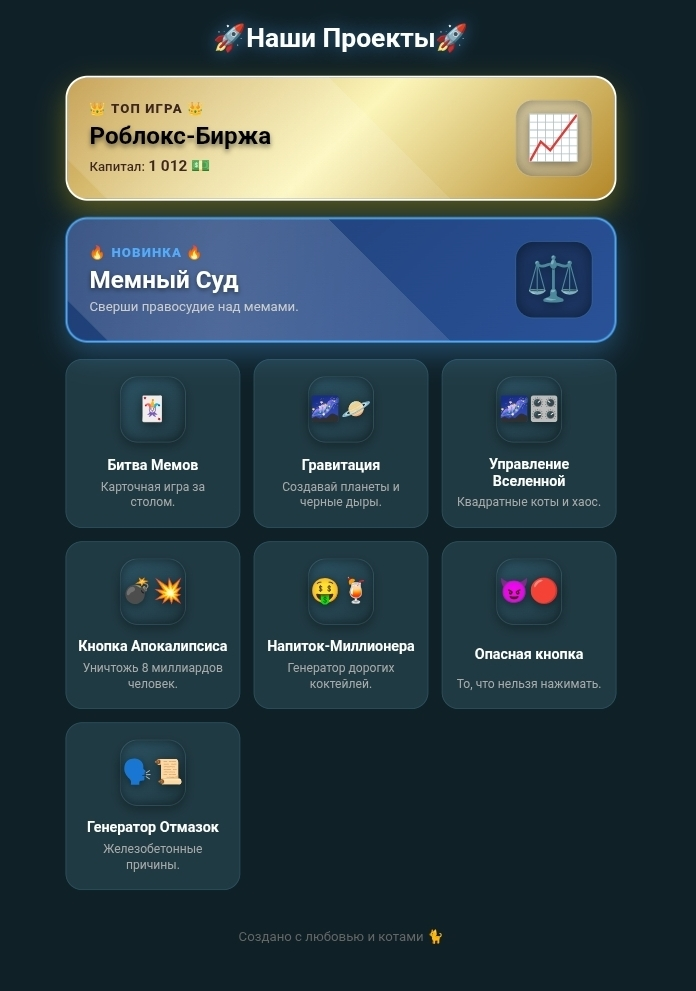

# 🚀Наши Проекты🚀

**[👉 ИГРАТЬ ЗДЕСЬ ](https://barabulka8xx-del.github.io/SiteOfCool/)** 👈

Добро пожаловать в `SiteOfCool`! Это коллекция крутых, мемных и интерактивных мини-игр, написанных на чистом HTML, CSS и JavaScript. Никаких тяжелых фреймворков, только чистая производительность и креатив.

## 🎮 Список игр

### 👑 ТОП ИГРА
*   **📈 Роблокс-Биржа** — Покупай акции игр, следи за графиком онлайна и зарабатывай миллионы. Лови моменты Хайпа и Пика популярности!

### 🔥 НОВИНКА
*   **⚖️ Мемный Суд** — Сверши правосудие над мемами. Выноси приговоры, отправляй в космос и зарабатывай монеты!

### 🎮 Остальные проекты
*   **🃏 Битва Мемов** — Карточная игра за 3D-столом. Используй мемные карты и уничтожь ботов.
*   **🌌🪐 Гравитация** — Создавай планеты и черные дыры тапами.
*   **🌌🎛️ Управление Вселенной** — Квадратные коты и хаос. Полный контроль над миром.
*   **💣💥 Кнопка Апокалипсиса** — Уничтожь 8 миллиардов человек. Тапай, покупай улучшения и запускай автокликер.
*   **🤑🍹 Напиток-Миллионера** — Генератор дорогих коктейлей, которые пахнут деньгами.
*   **😈🔴 Опасная кнопка** — То, что нельзя нажимать. Кнопка-ловушка, которая взрывает твой телефон.
*   **🗣️📜 Генератор Отмазок** — Железобетонные причины для работы, учебы и встреч с друзьями.

## 🛠️ Технологии

Проект создан с упором на простоту и производительность:
*   **HTML5** — семантическая верстка.
*   **CSS3** — неоновые эффекты, Glassmorphism, 3D-трансформации (`perspective`, `rotateX`), анимации.
*   **Vanilla JavaScript (ES6+)** — вся игровая логика без сторонних библиотек.
*   **Canvas API** — для отрисовки живых графиков на бирже.

## 👨‍💻 Автор

Создано с любовью и котами 🐈
